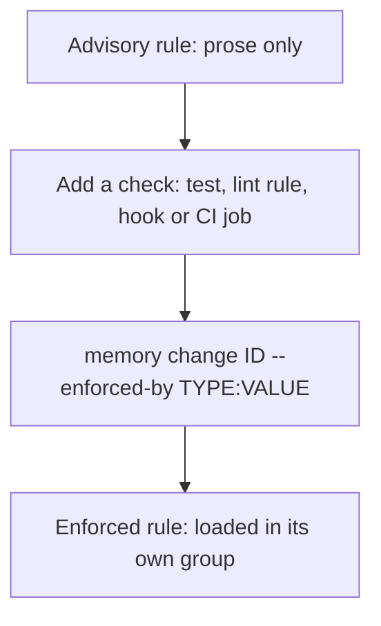
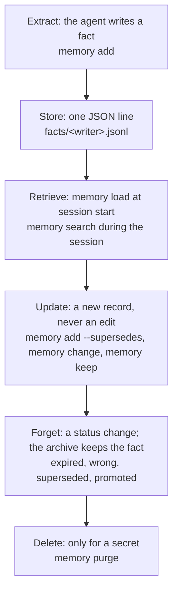

# Memory types

This page maps the common terms for agent memory onto what `memory` does.
The README has the short table. This page has the detail.

## Context and memory

- **Context** is the text the agent model reads now. Some people call it
  working memory. The agent tool owns it. `memory` does not.
- **Memory** is what stays after the session ends: the memory folder.
- Memory helps only when it goes into the context. `memory load` does that
  step. The session-start hook runs it. An agent with no hook gets the memory
  only when its instructions tell it to run `memory load`.

## Short-term and long-term

| Term | In `memory` | Loaded by `memory load`? | How it ends |
|---|---|---|---|
| Long-term | A fact with `scope: long`. This is the default. | Yes. Rules: all of them, first. Pinned facts: always. Other facts: the best scores (recency, kind, area, branch, and use), within the word budget (default 600 words). Rules do not use the budget. `memory load --explain` prints each score. | A status change. `memory tidy` proposes `expired` for a long-term fact older than 90 days with no links. |
| Short-term | A fact with `scope: short` (`memory add --short` or `--until-merged`). | Yes, for the current branch only, in about a quarter of the budget. | Read as `expired` after `expires_at` (default 14 days), or when its branch is merged or deleted. The read computes it; `memory tidy --auto` also writes it as `expired`, with a log line. `memory keep ID` makes it long-term. |
| Short-term prose | `branches/<branch>.md`. | The first 8 lines, on that branch only. | It does not end by itself. Delete or rewrite the file when the branch is done. |
| Current status | `notes/status.md`. | The first 8 lines, on every branch. | Rewrite it. Do not append. |
| Archive | Every fact and change in `facts/*.jsonl`. | No. Use `memory search WORDS --all` or `memory show ID`. | It does not end. Only `memory purge` removes a fact. |

A short-term fact with `--until-merged` shows on the branch it names. A
short-term fact without it shows to the writer that wrote it (the branch
name, or `MEMORY_WRITER`).

## Episodic and semantic

- **Episodic memory** records an event and its result: "The deploy failed
  because the pool was full. A larger pool fixed it."
- **Semantic memory** is a fact that is true without the story: "The service
  uses Postgres."

The `kind` field holds this. Do not change the kinds. They are part of the
record format.

| Kind | Type | Meaning | Load order |
|---|---|---|---|
| `event` | episodic | Something that happened, and its result. `happened_at` is the date of the event. | By score |
| `lesson` | semantic | The reusable part of one or more events. Link it to the event with `--link caused_by:ID`. | By score |
| `rule` | semantic | What an agent must or must not do. Enforced or advisory (see below). | First, all of them |
| `decision` | semantic | A choice and its reason. | By score |
| `trap` | semantic | Something that looks right and is wrong. | By score, with a small extra weight |
| `preference` | semantic | How the owner wants the work done. | By score, with a small extra weight |
| `fact` | semantic | Any other true statement. This is the default kind. | By score |

Every fact has `happened_at` (when it became true) and `learned_at` (when it
was written). For an event, `happened_at` is the date of the event. For a
semantic fact, it is the date the fact became true.

The score adds: how new the fact is (half-life 30 days), a match with the
areas of the files that this branch changed, and a match between tags and
branch-name words.

## Enforced and advisory rules

A rule is **enforced** when a check fails if an agent breaks it. The
`enforced_by` field names that check, as `<type>:<value>`:
`githook:commit-msg`, `lint:ruff:T201`, `test:tests/test_x.py`, `ci:<job>`.
A rule with no `enforced_by` is **advisory**: it is prose only.

- `memory add "..." --kind rule --enforced-by lint:ruff:T201` writes an
  enforced rule.
- `memory change ID --enforced-by ci:lint` marks a rule enforced.
  `memory change ID --no-enforced-by` makes it advisory again. Each one adds
  a change record.
- Only `kind: rule` can have `enforced_by`. Other kinds describe the
  project; they do not tell an agent what to do. When a trap gets a check,
  write the rule.
- `memory load` shows "Enforced rules (a check fails if broken)", then
  "Advisory rules". Both come first and do not use the word budget: only
  short-term and other long-term facts share it. `memory check` prints a
  note when the active rules hold more than 500 words.
- `memory check --advisory` lists the advisory rules. Each one is a place
  where a test, a lint rule or a hook can do the work of the note.
- The tool does not record when a rule is broken, so it cannot tell which
  rules break most often.

The `commits` rule against AI co-author trailers is enforced by
`githook:commit-msg` only when git runs the commit-msg guard: the local
guard, or the shared `.githooks/` guard with `core.hooksPath` set.
`memory hooks install` and `memory hooks uninstall` update it with a change
record. They never change a value that a person set. The other `commits`
rules stay advisory: they also cover pull requests, docs and wording, which no
hook can check.

A preset rule with `enforce_when` is marked enforced only when CI, or a git
hook that git runs, calls the check. A config file alone is not enough, and
neither is a hook file that git does not run. The shipped presets have no
such rule now. See [presets.md](presets.md#enforced-or-advisory).

## The lifecycle

| Step | Command | Notes |
|---|---|---|
| Extract | `memory add` | The agent writes the fact. The tool does not extract facts from a transcript. The tool refuses text that looks like a secret. |
| Store | (automatic) | One JSON line per record, in `facts/<writer>.jsonl`. Append only. |
| Retrieve | `memory load`, `memory search`, `memory show` | `memory load` is the session-start step. `memory search` ranks facts by BM25 over any word of the query (`--strict`: every word). When no whole word matches, it tries parts of longer words (`deploy` finds "deployment") and says so. It also finds lines in `notes/`, after the facts. `memory search --all` also finds facts that ended. |
| Update | `memory add --supersedes ID`, `memory change ID`, `memory keep ID` | Each adds a change record. The old state stays in the archive. `memory add` never refuses. It supersedes an exact repeat by itself, and it links a near repeat to the old fact with `similar_to`. An exact repeat of a rule or a pinned fact writes nothing. A `told` fact is never superseded by a fact with another basis; the new fact is written beside it. The same words as a retired fact are written with a `similar_to` link and a note. |
| Forget | `memory change ID --status expired\|wrong --reason ...` | The fact leaves the load. The archive keeps it with its reason. Short-term facts also end by date or merge, computed at read time. |
| Review | `memory tidy`, `memory tidy --apply ID ...` | Proposes stale facts and rules for the shared rules file. A person approves each one. Similar pairs go to the agent as a task in `proposals/tidy-followups.md`. |
| Clean-up | `memory tidy --auto` (also the session-start hook) | Retires exact duplicates and ended short-term facts (`auto_tidy = "auto"` reports first, then turns on). A change record and a log line for each, with the undo command. Never a rule or a pinned fact. |
| Delete | `memory purge ID --reason secret --yes` | The only real deletion. It leaves a tombstone with no content. |

### Replace or narrow

A new fact can disagree with an old one. Decide which case it is before you
write:

- **It replaces the old fact everywhere.** Use
  `memory add "NEW" --supersedes OLD --reason "..."`. The old fact becomes
  `superseded`.
- **It is true only in a smaller scope** (one area, one branch, one task).
  Keep the old fact. Add the new fact with that scope: a narrower `--area`,
  or `--short` / `--until-merged` for one branch. Add
  `--link related:OLD`, or `--link contradicts:OLD` when the two disagree.
  There is no special "narrows" link.
- **The old fact was never true.** Use
  `memory change OLD --status wrong --reason "..."`.

### A guess stays a guess

Every fact has a `basis`:

- `seen`: the agent observed it (a test run, a log, the code).
- `told`: a person said it.
- `guess`: the agent inferred it.

Write `seen` only for what you observed. `memory load` shows the basis on
each line, so the next session knows how far to trust the fact. A change
record cannot change the basis. To confirm a guess, add a new fact with
`--basis seen` and `--supersedes` the guess. `memory tidy` never proposes a
`guess` fact for the shared rules file.

## Where it works

### In a git repo

- Every worktree and every branch of one repo uses the same memory folder.
  The tool finds the main checkout from git, so this also works from a
  subfolder or from a linked worktree.
- Each branch writes to its own file (`facts/<branch>.jsonl`), so two agents
  on two branches do not conflict. Every reader merges all files.
- Short-term facts and `branches/<branch>.md` load only on their branch.
- Every agent tool on the same computer reads the same memory: the tools
  connected with `memory hooks install`, and any agent whose instructions
  tell it to run `memory load`.
- The memory is a local folder. A clone on a different computer has no
  memory folder unless you copy or sync it there and point `--path` or
  `MEMORY_DIR` at it.

### In a folder that is not a git repo

`memory` also works in a plain folder. Some features do less:

- **Subfolders find the project.** With no git, the tool walks up from the
  current folder to the nearest folder with a `memory-bank` link or a
  `.memory-path` file. That folder is the project. The walk does not check
  your home folder or the file system root. With no match, the current
  folder is the project.
- **`memory init` in a subfolder of a project is refused.** It names the
  project and its memory folder, and changes nothing. Run `memory init` in
  the project folder to change the setup.
- `--path` and `MEMORY_DIR` still choose the memory folder.
- There is no branch. The writer is `main` (or `MEMORY_WRITER`). `--short`
  works with its end date. `--until-merged` is refused: it needs a git repo.
  `branches/*.md` notes do not load.
- There is no ranking by changed files or branch name. Facts are ranked by
  age and kind only.
- There are no git hooks and no `.git/info/exclude`. Agent hooks still work.
  With no commit-msg guard, every `commits` rule is advisory.
