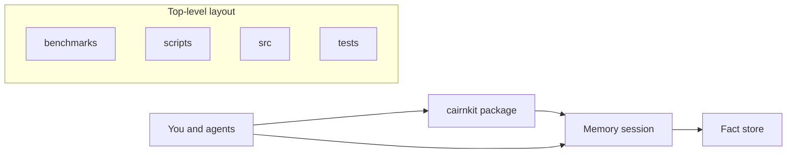

# cairnkit

A private, dated memory for any project. It lives outside the repo and is linked in.

This atlas was written by `memory docs`. Open the project folder in [Nessa Docs](https://github.com/nessalabs/nessa-docs) to browse the diagrams. Boxes with a + open a deeper page.

The root `sourceRevision` is the git commit inventoried for this system map. It is not a claim that every child page was behavior-reviewed at that commit. Child template pages omit `sourceRevision`.

